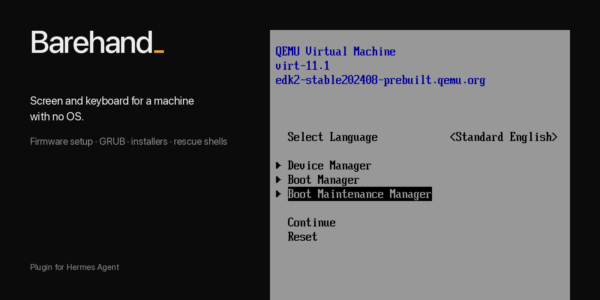
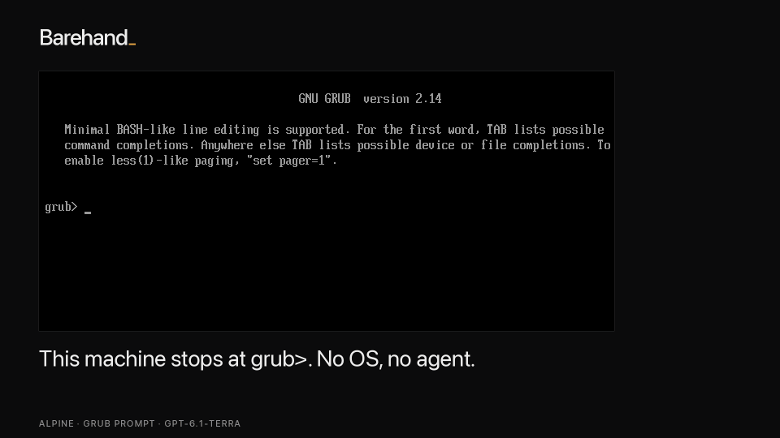

# Barehand



Barehand lets a Hermes agent operate a machine that has no OS, no network and no agent on it, using
only the screen and the keyboard.



*gpt-6.1-terra repairing an Alpine VM that stopped at `grub>`, in 40 tool calls.*

On QEMU guests on one Apple Silicon Mac, 12 of 12 rescue runs passed an independent judge across two
models, and `gpt-6.1-terra` installed Debian 13 and Ubuntu Server 26.04 on blank machines. Numbers,
limits and per-run evidence are in the [plugin README](barehand/README.md#what-is-measured).

```bash
hermes barehand demo                  # bundled recording, no QEMU, no model
hermes barehand up --enter-setup      # blank machine, lands in the firmware setup menu (needs QEMU)
```

Documentation and install: [barehand/README.md](barehand/README.md)

- `barehand/` is the plugin.
- `tests/` holds the unit tests; see [tests/README.md](tests/README.md) for how to run them.
- `.github/` holds the CI workflow.

Licence: MIT. The plugin needs QEMU and UEFI firmware (edk2/OVMF) on a Linux or macOS host, and a model that receives tool-result images.
