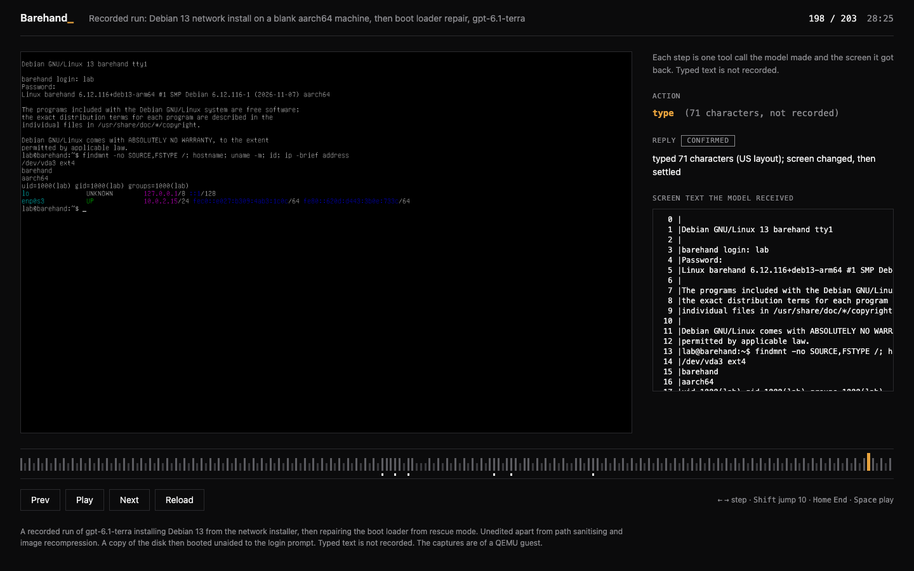

# Barehand reference

[Back to the README](../README.md)

## What it is and is not

Barehand is a raw display. `capture` always returns a PNG, whatever `mode` is asked, and zero
elements: there is no accessibility tree, no apps, no windows. Input is `key`, `type` (US-keyboard
ASCII), and `click` / `drag` / `scroll` by pixel coordinates of the latest screenshot (absolute
pointer through a `usb-tablet`).

After every input it waits for the screen to go quiet and reports an `effect`. A blinking caret
returns to the frame taken before the input; an edit does not.

- `confirmed` means the screen differs from the frame just before, and not only in a blinking caret
  or a region known to change by itself. It does not mean the input was accepted.
- Everything else is `unverifiable`, with a message saying what was seen: no change within the
  settle window (capture before repeating), a display that was not initialised (QEMU's "Display
  output is not active" banner) or had changed substantially, a resolution change, a change that
  went back, or a small region that keeps changing by itself (clock, spinner).
- `suspected_noop` is never emitted, because Hermes' hint for it talks about pixels and foreground
  delivery. `capture_after` still attaches the screenshot.
- Sending the identical input 3 or more times while the screen looked the same before each appends
  an advisory note. Nothing is ever refused.

An input costs about 1 s when nothing changes and about 1.7 s after a few typed characters (the
caret must blink back). A small region that changes by itself (a seconds clock) is cut off after
about 2 s on first sight and ignored in later inputs for 10 minutes. A slow ticker (period near 0.8
s) may still be reported `confirmed`. `element=`, `set_value` and `focus_app` answer
`unsupported_action`; `list_apps` and `list_windows` return empty lists.

The code uses only the standard library; Pillow downscales screenshots when available.

## Install details

The directory is the computer-use provider without enabling. Enabled as an ordinary plugin (`kind:
standalone`) it adds the `barehand_machine` tool, `hermes barehand ...`, `/barehand`, the
`barehand:barehand` skill and a short system-prompt section (active only when
`computer_use.backend` is `barehand`).

Hermes needs a model that receives tool-result images natively, for example
`agent.image_input_mode: native` for a local vision model. A text-only model gets an auxiliary
vision description, which loses which menu row is highlighted.

You need QEMU (`brew install qemu`, `apt install qemu-system-x86 ovmf`, ...); Barehand never
installs anything. `hermes barehand doctor` checks QEMU, firmware, endpoint and screenshots and
says what is missing. Before the first `up` it reports "no machine yet" as information, not a
failure.

If your Hermes version defers `computer_use` behind tool search, the model may not see it directly;
remove it from `tools.tool_search.defer` (not verified against the Hermes defaults).

## Commands

`hermes barehand [--machine NAME] <command>` selects one of several machines. `--machine` is
accepted before or after the command. Without a command it prints a short list, `demo` first.

- `up [--iso FILE] [--arch {auto,x86_64,aarch64}] [--disk-gb N] [--memory-mb N] [--cpus N]
  [--window] [--splash-ms N] [--fresh] [--enter-setup] [--yes]`. Defaults are 8 GB disk, 2048 MB
  memory and 2 CPUs; the machine is headless unless `--window` is given. `--iso` refuses a file
  that is not an ISO image. `--splash-ms` is the x86_64 firmware splash time in ms (default 15000, a 15 s splash, under
  software emulation, else 5000).
- `down [--purge] [--yes]`, `status`, `eject`, `doctor`.
- `reset [--enter-setup] [--seconds N]`. `--seconds` is how long Escape is held.
- `snapshot save|load|delete|list [name] [--overwrite]`.
- `recordings list|path|purge`, with `path [--latest]` and `purge [--yes]`.
- `atlases list|purge [--yes]`. An atlas is a learned table of a font's glyph shapes, used to read
  screen text.
- `demo [rescue|debian] [--list] [--no-open]` prints the path and `file://` URL of a bundled
  recording (default `rescue`; `--list` names both) and opens it. It needs no QEMU, config or
  model.
- `screen [--png FILE]` prints the running machine's screen as text (QMP or VNC; no vision model
  needed) and can save a screenshot.

`hermes computer-use doctor` runs the provider's checks.

`down --purge` and `up --fresh` delete the disk and all snapshots. They ask for confirmation on a
terminal and need `--yes` (or `BAREHAND_ASSUME_YES=1`) otherwise. The model is never pointed at
them.

### Entering firmware setup

The firmware ignores keys until its keyboard stack is up (tens of seconds on a cold boot under
software emulation), so Barehand over-sends. `reset --enter-setup` (the tool's `reset` with
`enter_setup=true`) holds Escape for a default that depends on guest and acceleration: x86_64 35 s
under software emulation and 12 s accelerated, aarch64 20 s and 6 s. The model is told to send
about 40 escapes in one `key` call. `key*N` repeats a key: N must be 1 to 64 (`a*0` is an error).
Type a literal `*` with `type` (or `shift+8`).

### Attaching an existing QEMU

Start it with `-qmp unix:/path/q.sock,server=on,wait=off` (or `tcp:127.0.0.1:PORT,...`), a
`usb-tablet` and the display you like. Then set `plugins.entries.barehand.settings.qmp:
unix:/path/q.sock` (or env `BAREHAND_QMP`). The screen tools, `barehand_machine`, `hermes barehand
status|reset|eject|snapshot` and `doctor` all honour it; `down` refuses, because the machine is not
Barehand's. Non-loopback hosts are refused unless `allow_remote: true`.

## Guest architecture

Barehand boots an x86_64 (q35 + OVMF) or an aarch64 (`virt` + EDK2) guest. Pick with `hermes
barehand up --arch {auto,x86_64,aarch64}` or the `arch` setting (default `auto`).

`auto` uses the architecture of the ISO you pass (`EFI/BOOT/BOOTAA64.EFI` vs `BOOTX64.EFI` inside
the image, else words such as `aarch64`/`arm64`/`amd64` in the file name), then that of the
machine's existing disk, then the host's own. An explicit `--arch` that contradicts the ISO is
refused. A machine's architecture is fixed for the life of its disk: `up` with a different one is
refused (use `up --fresh --arch ...` or `--machine <other-name>`).

Accelerator by host (x86_64 guest / aarch64 guest): macOS arm64 tcg / hvf; macOS x86_64 hvf / tcg;
Linux x86_64 kvm (if /dev/kvm is usable, else tcg) / tcg; Linux aarch64 tcg / kvm (if usable, else
tcg). Cross-architecture pairings run under TCG and are slower. Timings are under [What is
measured](../README.md#what-is-measured).

`hermes barehand doctor` reports what is missing for each architecture. The packages:

```bash
# macOS, both architectures
brew install qemu
# Debian/Ubuntu
apt install qemu-system-x86 ovmf                  # x86_64
apt install qemu-system-arm qemu-efi-aarch64      # aarch64
# Fedora
dnf install qemu-system-x86 edk2-ovmf             # x86_64
dnf install qemu-system-aarch64 edk2-aarch64      # aarch64
# Arch
pacman -S qemu-system-x86 edk2-ovmf               # x86_64
pacman -S qemu-system-aarch64 edk2-aarch64        # aarch64
```

Override discovery with `firmware_code_aarch64` / `firmware_vars_aarch64` (or
`BAREHAND_FIRMWARE_CODE_AARCH64` / `BAREHAND_FIRMWARE_VARS_AARCH64`). aarch64 `virt` needs both
flash banks to be 64 MiB; Barehand pads a private copy when a distro ships smaller images and never
modifies system files.

Hardware differences Barehand handles:

- aarch64 uses `virtio-gpu-pci`, never `ramfb`: the Linux console never appears on it.
- aarch64 uses a `virtio-scsi-pci` + `scsi-cd` CD-ROM, because its firmware cannot see AHCI/IDE
  CDs. The drive id stays `cdrom0`, so `eject` works the same.
- PCI slots are pinned on both architectures so a saved boot order survives restarts.
- After `up`, a self-check confirms QMP answers and a screendump produces a PNG. A failing machine
  is stopped.

Typing speed: `type_hold_ms` (0 = automatic) is 10 ms with hardware acceleration and 15 ms under
software emulation (5 to 20 ms never dropped a key in 3 trials; 60 ms lagged the guest about 12 s
after 150 characters). `key_hold_ms` is 60 ms.

## Configuration

The endpoint resolves in this order: env, then settings (`qmp`, or the VNC settings), then the
machine started by `up`. Settings live under `plugins.entries.barehand.settings` (declared in
`plugin.yaml`):

| Setting / env | Meaning |
|---|---|
| `transport` / `BAREHAND_TRANSPORT` | `qmp` or `vnc` (empty: vnc if only a VNC address is set, else qmp) |
| `qmp` / `BAREHAND_QMP` | endpoint of an existing QEMU: `host:port` (loopback) or `unix:/path` |
| `vnc_host`, `vnc_port`, `vnc` / `BAREHAND_VNC`, `vnc_password_env`, `vnc_encodings`, `vnc_timeout` | the VNC transport (see [Drive any machine over VNC](vnc.md#drive-any-machine-over-vnc)) |
| `machine` / `BAREHAND_MACHINE` | machine name (default `default`) |
| `allow_remote` | accept a non-loopback QMP host (unauthenticated full control: prefer an SSH tunnel) |
| `qemu_binary` / `BAREHAND_QEMU` | path to `qemu-system-x86_64` (or `-aarch64`) |
| `firmware_code`, `firmware_vars` / `BAREHAND_FIRMWARE_CODE`, `BAREHAND_FIRMWARE_VARS` | UEFI code image and vars template |
| `settle_quiet`, `settle_timeout`, `settle_delay`, `settle_poll` | screen-settling after an input (s) |
| `settle_blink` | seconds a cursor-sized change waits for the old frame to return before it counts as typed text (default 1.2; 0.05 to 60, else the default with one logged warning); `wait` uses it too |
| `key_hold_ms`, `type_hold_ms` | key hold times |
| `record`, `record_typed_text`, `record_keep_sessions`, `record_max_frames`, `record_max_mb`, `record_max_total_mb` | flight recorder (defaults: on, off, 10, 2000, 200, 2000; an invalid value falls back to the default with one logged warning) |
| `BAREHAND_HOME` | plugin data dir (default `<hermes home>/plugin-data/barehand`) |
| `BAREHAND_ASSUME_YES=1` | confirm destructive CLI options without prompting |

## Flight recorder



*The viewer (`index.html` opened from disk) at the last step: logged in as `lab`,
`findmnt`/`hostname`/`uname -m` (root on /dev/vda3 ext4, hostname barehand, aarch64), and `su -` to
root succeeded.*

Every action that reached the backend (input, capture, wait, `barehand_machine` call) and every
rejected input (with the reason) is appended to a JSONL ledger under `<data
dir>/recordings/<timestamp>-<machine>-p<pid>-<tag>/`, one folder per Hermes process. A record holds
the arguments, the digests of the frames before and after, the effect, the message and the snapshot
names known to the tool. Each distinct frame is saved once as a native-resolution PNG.

`index.html` is a static viewer. It reads `ledger.js`, a file of `BAREHAND.push({...});` lines
appended as the session runs, so it opens from `file://` with no server (press "reload" to pick up
new actions). The `text` field of a record is `null` today. The recorder never fails an action: its
errors are caught and logged once.

A `type` record holds only the string's length unless `record_typed_text: true`, which stores the
text, passwords included. Key chords are always stored (a password sent as `key` presses is in the
ledger), and so are the screenshots, which show anything the guest echoes. Failure messages can
echo error text, and Hermes' own session transcript holds every `type` call regardless of this
plugin. Set `record: false` when you will enter secrets. Files are mode 0600 and folders 0700
(existing ones are tightened; symlinks not followed), but anything that can read your Hermes data
dir can read them.

The newest `record_keep_sessions` sessions (10, over all machines) are kept. Only finished sessions
are deleted: pruning and `purge` leave alone one whose process holds the lock on `.lock`. Oldest
sessions also go while the total is above `record_max_total_mb` (checked when a session starts). A
session stops saving screenshots after `record_max_frames` distinct frames or `record_max_mb` MiB
(one `recorder_note`; actions continue without frames) and stops recording after 20000 records.
Manage sessions with `hermes barehand recordings list|path [--latest]|purge [--yes]`. `purge` needs
`--yes` or `BAREHAND_ASSUME_YES=1` off a terminal and touches only folders that hold a ledger.

## The `barehand_machine` tool

Actions: `status` (also reports whether installer media is inserted, the display size,
`initialised: false` only for QEMU's "Display output is not active" banner, and `blank: true` for a
live display showing one flat colour), `snapshot_save|load|list|delete` (`save` refuses an existing
name unless `overwrite: true`; the CLI flag is `--overwrite`), `reset` (`enter_setup` optional;
also powers a shut-down machine back on), `power_off` (ACPI), `eject_media`, `send_ctrl_alt_del`,
`calibrate_text`, `wait_for_text`.

Hermes hard-blocks chords such as ctrl+alt+delete and alt+f4 before any backend sees them, so this
tool is how the model resets or checkpoints the target. Barehand's own `key` path also blocks
ctrl+alt+delete in every spelling (`delete`, `del`, `forwarddelete`, either ctrl/alt side, any
order) and points to `send_ctrl_alt_del`, the approval-gated action. The `reset` and
`snapshot_load` results carry a screen-text tail (1 s budget, with a connection timeout no longer
than that).

`wait_for_text` waits up to 240 s (`timeout`, default 60) until `text` appears on a screen that can
be read as text. It matches per row, case-sensitively, as a substring unless the text starts with
`re:`. A `re:` pattern is a restricted regular-expression subset: at most 200 characters and no
quantified groups (details in [screen-text.md](screen-text.md)). Other actions fail as busy while
it waits.

Which actions ask for human approval is listed under [Disclosure](../README.md#disclosure). The
gate covers the tool, not the `hermes barehand` CLI, which is a human interface.

A guest shutdown or `power_off` leaves QEMU in the `shutdown` state (`-no-shutdown`), as does a
paused VM: `status` shows it, input fails with `vm_not_running`, and `reset` powers the machine
back on.

## Reference notes

- Snapshots on Apple Silicon with hardware acceleration (aarch64 with HVF) are disk checkpoints.
  The VM is paused and one QMP transaction takes internal qcow2 snapshots of the disk and the
  variable store (`snapshot list` shows `disk checkpoint` or `full snapshot`). Loading one stops
  QEMU, runs `qemu-img snapshot -a` on both images and starts QEMU again. Memory is not saved and
  the guest is not asked to sync, so a checkpoint is crash-consistent.
- Everywhere else a snapshot is a full snapshot: QEMU `savevm`/`loadvm`, which needs qcow2 disks
  and a qcow2 UEFI variable store (`up` creates both). Full snapshots made earlier on aarch64 can
  still be loaded. After a full snapshot save or load in the same QEMU process, the guest hangs on
  a reset or a UEFI variable write (efibootmgr, grub-install, an installer's boot entry), so
  `reset` relaunches QEMU (a cold boot; disk and snapshots are kept). It relaunches only a QEMU
  that Barehand started.
- Pointer coordinates, buttons and wheel were verified in a Linux guest. EDK2 setup menus ignored
  clicks; use the keyboard there.
- A boot order saved in firmware survives only while the device layout is identical (EDK2 stores
  PCI device paths). `up` pins every device to a fixed slot and always creates the CD-ROM
  controller and drive (empty without `--iso`), so ISO, window or headless, memory and CPU count do
  not change the layout. A machine made by an older Barehand has a different layout: re-save its
  boot order once; its QEMU snapshots cannot be loaded. A new QEMU machine type or version can
  still change paths.
- Hermes resolves plugin skills only as `<plugin>:<skill>`, so the skill is `barehand:barehand`
  (the bare name `barehand` is not found). The system-prompt section names it and carries the key
  rules.
- A still screen does not mean an operation finished (silent kernel boot, installer steps); look
  for a prompt.

## Packer, openQA, kickstart and cloud-init

Use those when you know the path in advance. Packer's `boot_command` needs a fixed key script per
installer version and types blind on an unexpected screen. openQA needs hand-written needles
(reference images) per screen and repairs an existing machine only if you scripted that exact
fault. Kickstart, preseed and cloud-init need an installer that reads an answer file or datasource
and cannot repair an existing machine.

Barehand needs nothing on the target and reads the screen with a model, so it fits one-off,
unscripted or never-seen situations; repair is its main use. Each run costs model calls and
minutes, where the others are repeatable, fast and model-free. If the installer supports an answer
file, or you will run the same flow a hundred times, script it or write needles.

## Limit details

Continued from the plugin isolation limit in the README.

- With an attached QMP endpoint (`qmp` setting / env), `reset` sends `system_reset`, checks the
  display and reports that it did not relaunch. If the display stays dead, run `hermes barehand
  down` (if QEMU still runs), then `hermes barehand up`.
- An ejected disc stays ejected across a relaunch: `eject_media` is remembered in the machine
  state, `up` without `--iso` starts with an empty drive, and a new `--iso` inserts it again.
- This plugin was not run in host mode, and whether the `computer_use` provider loads there is
  unverified (Hermes refuses to import user-supplied provider code in-process under host mode). You
  would also have to start QEMU yourself ([Attaching an existing
  QEMU](#attaching-an-existing-qemu)).

## Disclosure details

Continued from the README Disclosure list.

- The QMP control endpoint is a unix socket in a 0700 directory (the machine directory, or a
  private temp directory when the path is too long). If neither fits, it is a loopback TCP port on
  127.0.0.1. QMP is unauthenticated full control, so any local user could use the TCP fallback.
- Barehand writes only the plugin data dir (state and logs mode 0600) and short-lived screendump
  files (guest screen contents) in a private temp directory, deleted after each read.
- `down` signals a process only after checking that its command line is the QEMU Barehand started.